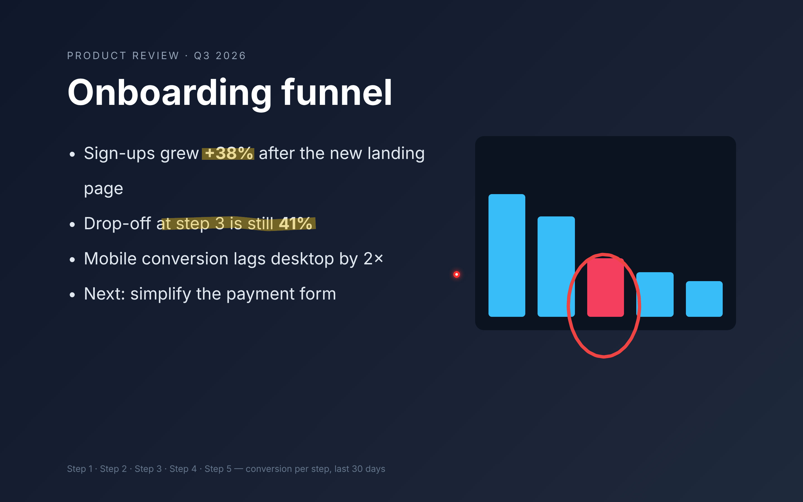
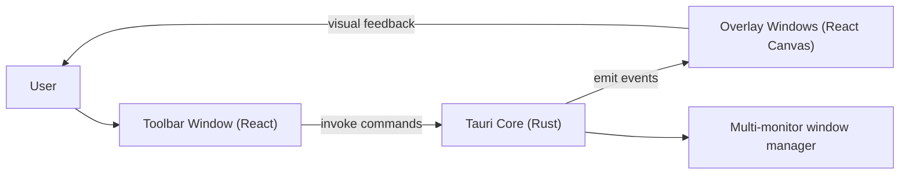

# Mira



> Show what you mean.

Mira is a lightweight desktop annotation overlay for live presentations, demos, and teaching.
You can draw on top of any app, highlight key points, and clear everything quickly without leaving your flow.

This project was created to solve a real day-to-day presentation problem and to learn Tauri by building a real product with AI-assisted development.
If this is useful for your workflow, feel free to use it, adapt it, and contribute.

## What Mira Does

- Opens a transparent, always-on-top drawing overlay
- Provides a floating, low-profile draggable toolbar
- Pen, highlighter, eraser, and shapes (line, rectangle, ellipse, arrow)
- Highlighter that behaves like a real marker: yellow by default, uniform color where strokes overlap, sits under pen ink, `Shift` for straight lines
- ZoomIt-style zoom: freeze the screen, magnify around the cursor, scroll to change level, draw on the zoomed view
- Laser pointer with a fading trail (clicks still go to the app underneath)
- Text annotations (click to place, click again to edit or drag)
- Color and stroke controls
- Undo / redo / clear (eraser and clear are fully undoable)
- Spotlight pointer for live presentations
- Multi-monitor overlays
- macOS only (built with Tauri; Windows/Linux are not maintained)
- Reliable global shortcuts (no fake settings UI)

## Why This Exists

During live calls and presentations, switching tools breaks flow.
Mira keeps annotation controls instantly available on top of your screen so explanations stay visual and fast.

## Tech Stack

- Tauri 2 (Rust backend + desktop shell)
- React 19 + TypeScript (UI)
- Vite (frontend build)
- Bun (package/runtime tooling)

## Architecture

Mira follows a split-window architecture:

- `toolbar` window: compact floating controller
- `overlay*` windows: transparent per-monitor drawing surfaces
- Rust core: creates/manages windows, handles positioning, and command/event bridge

Frontend windows call Rust commands (`invoke`), and Rust emits events back to overlays/toolbars for synchronized state changes.



## Project Structure

```text
mira/
  src/
    components/
      Toolbar.tsx
      Canvas.tsx
    hooks/
      useDrawing.ts
    types/
  src-tauri/
    src/
      lib.rs
    tauri.conf.json
```

## Keyboard Shortcuts

| Shortcut | Action |
|---|---|
| `Ctrl+Shift+X` | Toggle overlay on/off |
| `Ctrl+Shift+D` | Toggle draw mode |
| `Ctrl+Shift+C` | Clear canvas |
| `Ctrl+Shift+Z` | Undo |
| `Ctrl+Shift+Y` | Redo |
| `Ctrl+Shift+S` | Toggle spotlight |
| `Ctrl+Shift+L` | Toggle laser pointer |
| `Ctrl+Shift+M` | Zoom in/out (scroll = level, drag = draw, `Esc`/right-click = exit) |
| `Esc` (overlay focused) | Leave draw mode |

On macOS, grant Accessibility permissions in System Settings for global shortcuts.
Zoom needs **Screen Recording** permission (System Settings → Privacy & Security → Screen Recording). If the zoomed view shows only your wallpaper, that permission is missing.

## Getting Started

### Prerequisites

- [Rust](https://rustup.rs/)
- [Bun](https://bun.sh/)
- macOS (primary tested target)

### Run in development

```bash
bun install
bun run tauri dev
```

### Build

```bash
bun run tauri build
```

## Contribution

Contributions are welcome.

1. Fork the repository
2. Create a feature branch
3. Make focused changes with clear commit messages
4. Open a pull request with:
   - what changed
   - why it changed
   - screenshots/gifs for UI updates

Please keep changes small and practical, and prefer incremental improvements.

## Project Info

- Author: Pedro Santos
- Repository: [p-c-g-s/MIRA](https://github.com/p-c-g-s/MIRA)

