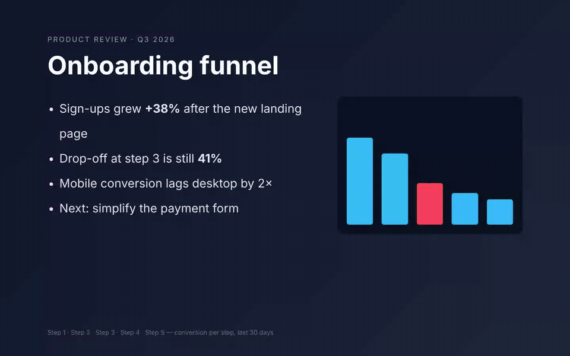
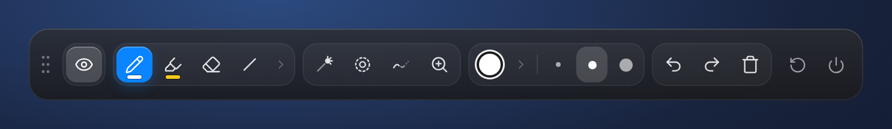
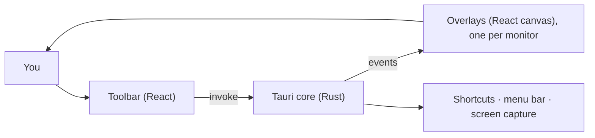

<p align="center">
  
</p>

<h1 align="center">Mira</h1>

<p align="center"><b>Show what you mean.</b><br/>
A lightweight screen annotation overlay for macOS — draw, highlight, point and zoom on top of any app while you present.</p>

<p align="center">
  
</p>

<p align="center">
  
</p>

> The demo above is the real Mira interface rendered in a browser with the native layer simulated, on a sample slide. A recording from the macOS app is coming.

## Why

During live calls, standups and demos, switching tools breaks your flow. Mira keeps a small toolbar and a transparent drawing layer on top of your screen, so you can explain visually and get back to work in a second.

## Features

**Draw**
- Pen, highlighter, eraser, line, rectangle, ellipse, arrow and text
- A highlighter that behaves like a real marker: yellow by default, even color where strokes overlap, sits under your pen ink, hold `⇧` for a straight line
- `⇧` also snaps lines/arrows to 45° and makes perfect squares/circles
- Undo, redo and clear (all undoable)

**Present**
- **Zoom** (ZoomIt-style): freeze the screen and magnify around the cursor; scroll to change level, draw on the zoomed view, `Esc` to exit
- **Laser pointer** with a fading trail — clicks still go to the app underneath
- **Spotlight** ring that follows the cursor
- **Fading ink**: annotations disappear on their own after a few seconds — great for standups

**Stay out of the way**
- The toolbar is **hidden from screen sharing**: your audience sees the annotations, not the controls
- Menu bar icon with every action and **Open at Login**
- Global shortcuts for everything, multi-monitor support (including hot-plugged displays)

## Keyboard shortcuts

| Shortcut | Action |
|---|---|
| `⌃⇧D` | Toggle draw mode (pen) |
| `⌃⇧L` | Laser pointer |
| `⌃⇧M` | Zoom (scroll = level, drag = draw, `Esc`/right-click = exit) |
| `⌃⇧F` | Fading ink |
| `⌃⇧S` | Spotlight |
| `⌃⇧Z` / `⌃⇧Y` | Undo / Redo |
| `⌃⇧C` | Clear |
| `⌃⇧X` | Show/hide the overlay |
| `⌃⇧H` | Show/hide the toolbar |
| `Esc` | Leave draw mode |

## Install & run

Mira targets **macOS**. There are no signed downloads yet, so for now run it from source:

```bash
# Prerequisites: Rust (https://rustup.rs) and Bun (https://bun.sh)
git clone https://github.com/pc-gs/MIRA.git
cd MIRA
bun install
bun run tauri dev        # run in development
bun run tauri build      # build Mira.app / .dmg into src-tauri/target/release/bundle/
```

### macOS permissions

Grant these in **System Settings → Privacy & Security** (in development, grant them to your terminal app):

- **Accessibility** — needed for the global shortcuts.
- **Screen Recording** — needed for zoom. If the zoomed view shows only your wallpaper, this permission is missing.

### Using it in video calls

Annotations reach Meet, Zoom or Teams only when you share your **entire screen**. Sharing a single window doesn't include Mira's overlay.

## How it works

Mira is a [Tauri 2](https://tauri.app) app: a Rust core plus a React + TypeScript UI.

- A small **toolbar** window holds the controls and owns the state.
- One transparent, always-on-top **overlay** window per monitor does the drawing. Overlays are click-through until you start drawing.
- The Rust core creates and positions the windows, registers global shortcuts and the menu bar icon, streams the cursor position, and captures the screen for zoom. It relays events between the toolbar and the overlays.



The [architecture notes in `CLAUDE.md`](CLAUDE.md) describe the event contract in detail. The roadmap and known gaps are in [`NEXT_STEPS.md`](NEXT_STEPS.md).

## Contributing

Contributions are welcome. Keep changes focused, and include a screenshot or GIF for UI changes. Before opening a PR, run:

```bash
bun run build     # TypeScript typecheck + frontend build
```

## About

Built by Pedro Santos to solve a real day-to-day presentation problem and to learn Tauri by building a real product with AI-assisted development. If it's useful to you, feel free to use it, adapt it, and contribute.
